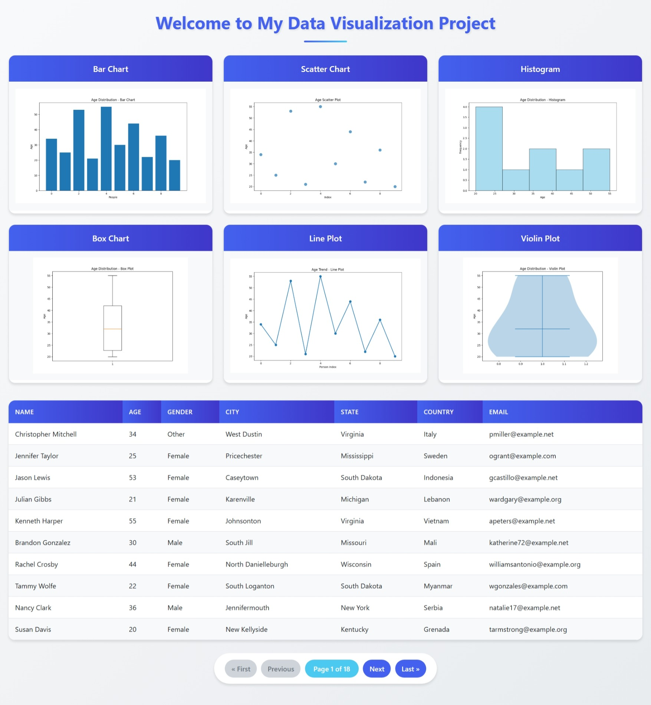

# 📊 Django Dynamic Data Visualization Dashboard

[](https://www.python.org/)
[](https://www.djangoproject.com/)
[](https://www.docker.com/)
[](https://opensource.org/licenses/MIT)
[](https://www.linkedin.com/in/govardhan-mandal-268121440/)

A full-stack Django web application designed for automated statistical data generation, relational persistence, and dynamic multi-chart visualization analytics.

---

## 🖼️ Dashboard Preview



---

## 🚀 Key Features

* 📊 **Multi-Chart Analytics Suite:** Generates dynamic statistical plots including Bar charts, Scatter plots, Histograms, Box plots, Violin plots, and Line charts.
* 📋 **Paginated Data Explorer:** Responsive data table with server-side pagination (10 records/page) and rapid search filters.
* 🤖 **Automated Synthetic Data Generator:** Integrated `Faker` engine that populates relational SQLite/PostgreSQL schemas with thousands of realistic records on demand.
* 🎨 **Modern Cyberpunk UI:** Built with responsive CSS Grid, glassmorphic cards, smooth interactive transitions, and mobile viewport adaptability.
* 🐳 **Docker & Compose Ready:** Containerized setup for deterministic local or cloud deployments.

---

## 🛠️ Technology Stack

* **Backend:** Python 3.x, Django Web Framework (MVC Architecture)
* **Database:** SQLite3 / PostgreSQL with Django ORM
* **Data Synthesis & Computation:** Faker, Pandas, NumPy
* **Visualization Libraries:** Matplotlib, Seaborn, Plotly
* **DevOps:** Docker, Docker Compose, Gunicorn

---

## 💻 Installation & Quickstart

```bash
# 1. Clone the repository
git clone https://github.com/Govardhanmandal9421/django-data-visualization-dashboard.git
cd django-data-visualization-dashboard

# 2. Create and activate virtual environment
python -m venv venv
# On Windows:
venv\Scripts\activate
# On Linux/macOS:
source venv/bin/activate

# 3. Install dependencies & run migrations
pip install -r requirements.txt  # or: pip install django faker pandas matplotlib seaborn
python manage.py migrate

# 4. Launch local development server
python manage.py runserver
```

Open `http://127.0.0.1:8000` in your web browser.

---

## 👨‍💻 Author & Connect

* **Developer:** Govardhan Mandal
* **Portfolio:** [govardhanmandal9421.github.io](https://govardhanmandal9421.github.io)
* **LinkedIn:** [linkedin.com/in/govardhan-mandal-268121440](https://www.linkedin.com/in/govardhan-mandal-268121440/)
* **GitHub:** [github.com/Govardhanmandal9421](https://github.com/Govardhanmandal9421)
* **Email:** [g.s.mandal433@gmail.com](mailto:g.s.mandal433@gmail.com)
